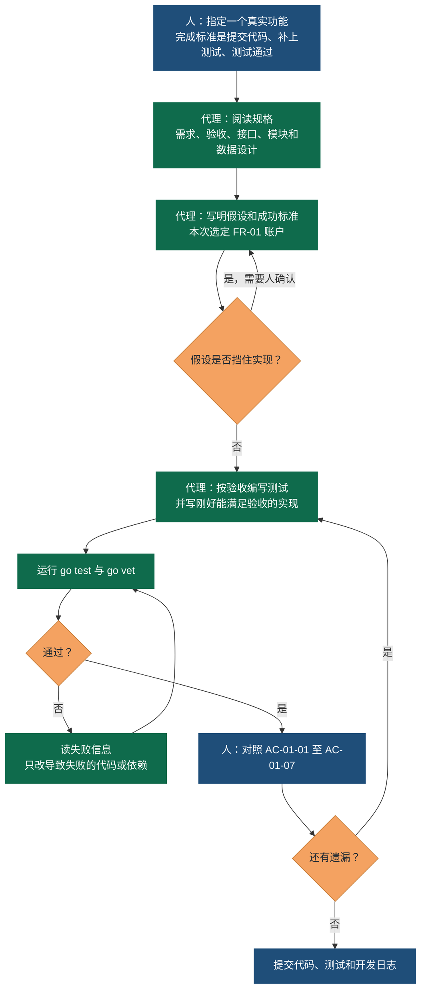

# FR-01 账户功能的开发轨迹

这张图记录一次编码代理完成真实功能的回路。菱形是回路的出口：假设不清就回到人，测试失败就只改失败的部分，验收有缺口就补测试。本次实际走过的路径用深色节点表示，没有发生的分支留在图上，因为下一次功能仍会经过它们。

本次运行的记录：

1. 人给出作业：完成 1 个真实功能，提交代码，补测试，测试通过，并留下开发日志和轨迹图。
2. 代理读完 FR-01、AC-01 和接口第 4 节，选定账户注册、登录、退出、修改密码。
3. 假设没有挡住实现：账户先放在内存仓库；邮箱验证留到 FR-24；5 分钟登录压测不进入这次的单元测试。
4. 第一次 `go test` 时，最新的 `golang.org/x/crypto` 要求 Go 1.26，工具链被自动切换。测试本身通过。
5. 代理把 Go 钉在 1.22，把依赖钉在 jwt v5.2.2 和 crypto v0.31.0，再次测试通过。
6. 对照 AC-01-01 至 AC-01-07 后提交。AC-01-08 和 FR-24 明确留在图外。

渲染图见 [trajectory.png](trajectory.png)。
